<div align="center">

# 🏠 House Price Prediction — Regression with Supervised Learning

**An end-to-end machine-learning project: from raw Ames Housing data to a tested, deployable price estimator**


*Red & White Skill Education · Practical Exam · Supervised Learning · Set A*

</div>

---

## 📑 Table of contents
1. [Project overview](#-project-overview)
2. [Headline results](#-headline-results)
3. [Dataset](#-dataset)
4. [Methodology](#-methodology)
5. [Models & results in detail](#-models--results-in-detail)
6. [Model diagnostics](#-model-diagnostics)
7. [What drives the price? (interpretation)](#-what-drives-the-price-interpretation)
8. [Saved pipeline & Streamlit web app](#-saved-pipeline--streamlit-web-app)
9. [Project structure](#-project-structure)
10. [How to run](#-how-to-run)
11. [Reproducibility](#-reproducibility)
12. [Limitations & future work](#-limitations--future-work)
13. [Exam deliverables checklist](#-exam-deliverables-checklist)
14. [Video, links & credits](#-video-links--credits)

---

## 🎯 Project overview

**Scenario.** You are a Junior Data Scientist at a PropTech start-up (think NoBroker or MagicBricks). The product team wants an **automated property-value estimator** that gives buyers and sellers an objective benchmark price.

**Task.** Build a complete supervised-learning pipeline that predicts the **sale price of a house** (a *regression* problem) from 79 descriptive features, using the Ames Housing dataset.

**What this repository contains**
- a fully executed **Jupyter notebook** covering problem framing → EDA → preprocessing → 5 models → tuning → evaluation → residual analysis → interpretation (incl. SHAP) → pipeline export;
- a **single scikit-learn `Pipeline`** saved as `models/house_price_model.pkl` that accepts *raw* data rows and returns a price in **USD**;
- a **Streamlit web app** (`app/app.py`) for interactive price estimates;
- tests, a ~450-word summary report and a deployment guide.

**Design principles**
| Principle | How it is applied |
|---|---|
| **No data leakage** | Every data-dependent step (median imputation, target encoding, scaling, one-hot categories) lives *inside* the Pipeline and is fitted on training rows only. Cross-validation re-fits the whole pipeline in each fold. |
| **Honest metrics** | All RMSE / MAE / R² values are computed **after `expm1()`**, i.e. in original USD. Log-scale numbers are always labelled. |
| **Model choice without peeking** | The "best" model is chosen by **5-fold CV on the training split**, not by the test set; the test set is used once for the final report. |
| **Reproducible** | `random_state=42` everywhere, pinned library versions, fixed 80/20 split. |

---

## 🏆 Headline results

> **Best model: Ridge Regression** (`RidgeCV`, α = 10) inside a full preprocessing pipeline.

| Metric (hold-out test set, 292 houses) | Value |
|---|---|
| **RMSE** | **$19,763** (≈ 11.8 % of the median price of $167,050) |
| **MAE** | **$14,242** |
| **R²** | **0.9293** |
| **MAPE** | 8.3 % |
| Predictions within ±10 % of true price | 71.6 % |
| 5-fold CV RMSE (training split) | $22,655 ± $2,742 (log scale: 0.1171 ± 0.0077) |

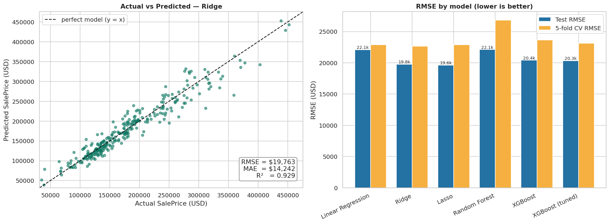

**In one sentence:** a regularised linear model on a carefully engineered, log-transformed problem explains **~93 % of the variance in house prices** and is typically within **~$14k** of the true price — matching or beating gradient boosting here while being far simpler to explain and deploy.

---

## 📦 Dataset

| | |
|---|---|
| **Source** | [Kaggle — House Prices: Advanced Regression Techniques](https://www.kaggle.com/competitions/house-prices-advanced-regression-techniques/data) (Ames, Iowa residential sales, 2006–2010) |
| **File used** | `train.csv` only (per the exam; own 80/20 split) |
| **Size** | 1,460 rows × 81 columns → 79 features + `Id` + target |
| **Feature types** | 36 numerical, 43 categorical |
| **Target** | `SalePrice` — continuous, **USD** |
| **Split** | 80 % train (1,166) / 20 % test (292), `random_state=42` (after removing 2 outliers → 1,458 rows) |

`train.csv` is git-ignored — download it from the Kaggle link and place it in `data/`.

> **Loading note.** In this file the text `NA` means *"feature absent"* for categorical columns (no pool, no garage…), and pandas would silently turn the genuine category `"None"` into NaN. The notebook therefore reads the data with `keep_default_na=False, na_values=["NA"]`.

---

## 🔬 Methodology

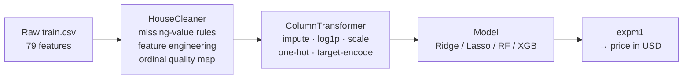

### 1 · Problem framing & theory
The notebook opens with concise answers (2–4 bullets each) to the five required theory questions: regression vs classification (with Indian examples — HDFC EMI prediction, Maharashtra crop yield), Simple/Multiple/Ridge/Lasso regression, over/under-fitting, RMSE vs MAE vs R², and k-fold cross-validation.

### 2 · Exploratory data analysis — key findings
| Finding | Evidence |
|---|---|
| **Target is right-skewed** → log-transform | skewness 1.88 → **0.12** after `log1p`; Shapiro–Wilk rejects normality for the raw target |
| **Most-skewed features** | `MiscVal` (24.5), `PoolArea` (14.8), `LotArea` (12.2), `3SsnPorch` (10.3), `LowQualFinSF` (9.0) |
| **Strongest correlates of price** | `OverallQual` (0.79), `GrLivArea` (0.71), `GarageCars` (0.64), `GarageArea` (0.62), `TotalBsmtSF` (0.61), `1stFlrSF` (0.61) |
| **Location matters** | median price ranges from **$88,000** (MeadowV) to **$315,000** (NridgHt); NoRidge ($301,500) and StoneBr ($278,000) follow |
| **Two clear outliers** | houses with `GrLivArea > 4000` but `SalePrice < $300k` (Id 524 and 1299, both *partial* sales) |
| **Missing data** | 19 columns have missing values; `PoolQC` 99.5 %, `MiscFeature` 96.3 %, `Alley` 93.8 %, `Fence` 80.8 % |

| Target distribution | Correlation heatmap |
|---|---|
| 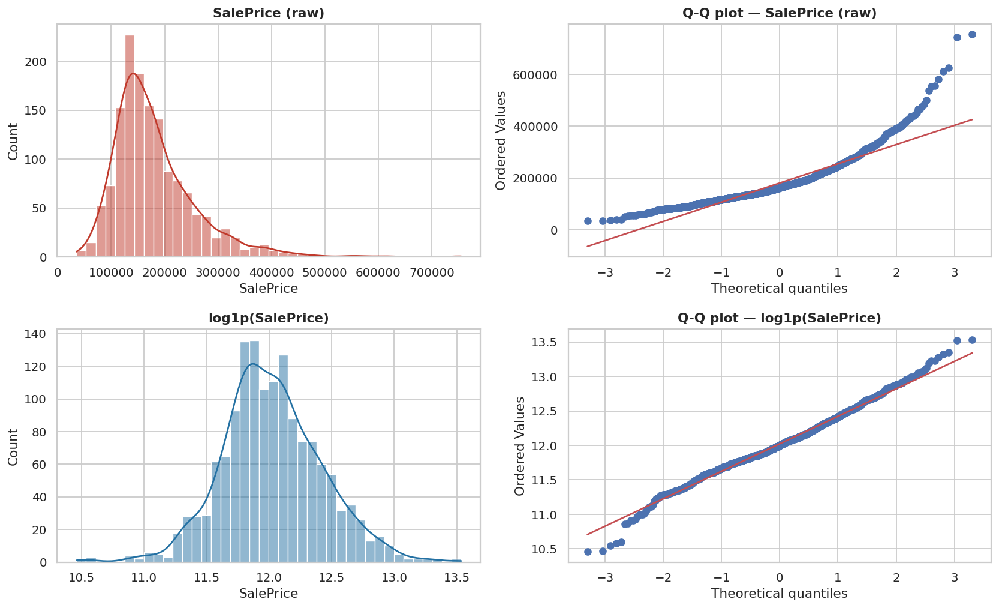 | 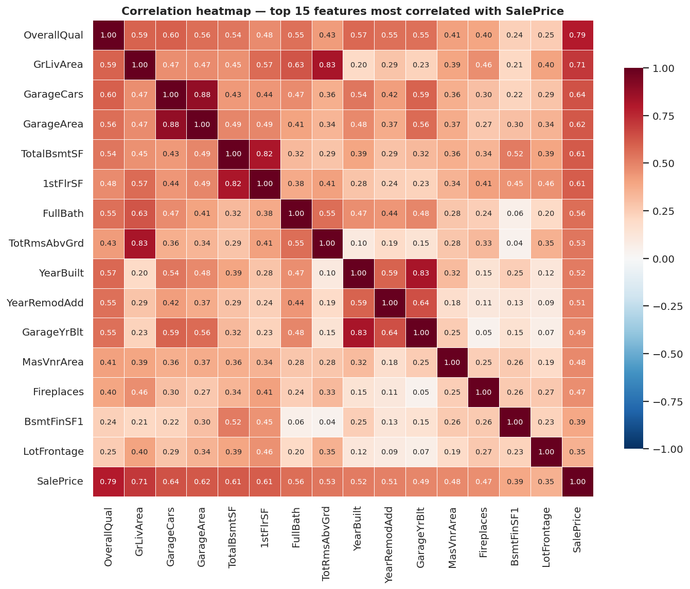 |

| Outliers in key scatter plots | Price by quality & neighbourhood |
|---|---|
| 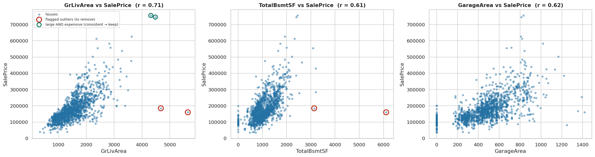 | 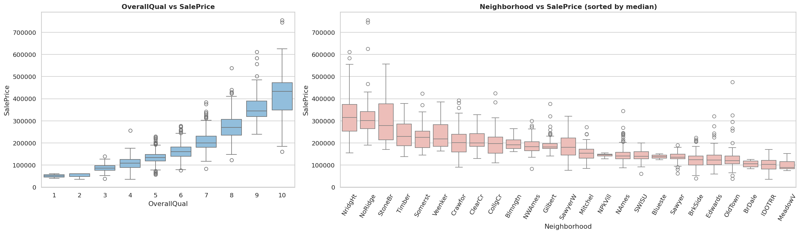 |

### 3 · Preprocessing & feature engineering
| Step | What is done | Why |
|---|---|---|
| **Missing values** | Drop columns with > 80 % missing (`PoolQC`, `MiscFeature`, `Alley`, `Fence`); categorical NaN meaning *absent* → `"None"`; count/area NaN → `0`; remaining numeric NaN (`LotFrontage`, `GarageYrBlt`) → **median**, `Electrical` → most frequent (both inside the Pipeline) | follows the data dictionary; no leakage |
| **Outlier removal** | drop the 2 rows with `GrLivArea > 4000` & `SalePrice < 300000` | high-leverage, unfinished sales; they bend a linear fit — fitted slope falls from **$115 → $107 per sq ft** and R² from 0.540 → 0.502 on a simple GrLivArea fit |
| **Feature engineering** | `TotalSF` = basement + 1st + 2nd floor · `HouseAge` · `RemodAge` · `HasGarage` · `HasPool` | captures total usable area, age and amenity flags |
| **Ordinal encoding** | `ExterQual, KitchenQual, BsmtQual, FireplaceQu` **+** `ExterCond, BsmtCond, HeatingQC, GarageQual, GarageCond`: `Po→1, Fa→2, TA→3, Gd→4, Ex→5, None→0` | quality is naturally ordered |
| **One-hot encoding** | nominal columns with ≤ 10 categories (`BldgType`, `HouseStyle`, `SaleCondition`, …) | no artificial order |
| **Target (mean) encoding** | high-cardinality nominals: `Neighborhood`, `Exterior1st`, `Exterior2nd`, `MSSubClass` — `TargetEncoder` with smoothing and **internal 5-fold cross-fitting** | avoids 20+ dummy columns and target leakage |
| **Skew correction** | `log1p` on continuous columns with skewness > 0.75 (measured on *train* only) | stabilises linear models |
| **Scaling** | `StandardScaler` on all numeric features | required for Ridge/Lasso penalties |
| **Target** | `y = log1p(SalePrice)`; predictions mapped back with `expm1` | errors become percentage errors |

Result: **196 processed features** feed the models.

> 🛠️ **A leakage bug caught by design.** During development an internal assertion (*"standalone model predictions must equal pipeline predictions"*) revealed that building the training matrix with `fit()` + `transform()` gave the standalone models in-sample target encodings. The fix (`fit_transform`, which cross-fits) is in the final notebook.

---

## 📊 Models & results in detail

All numbers on the **original USD scale**, hold-out test set (n = 292). *CV RMSE* = 5-fold CV on the training split with the full pipeline re-fitted per fold.

| Model | RMSE | MAE | R² | MAPE | Within ±10 % | 5-fold CV RMSE (± std) | Train time |
|---|---:|---:|---:|---:|---:|---:|---:|
| Linear Regression | $22,104 | $15,350 | 0.9115 | 8.83 % | 69.9 % | $22,898 ± 2,396 | 0.02 s |
| **Ridge** (L2) ⭐ | **$19,763** | **$14,242** | **0.9293** | **8.32 %** | **71.6 %** | **$22,655 ± 2,742** | 0.04 s |
| Lasso (L1) | $19,621 | $14,271 | 0.9303 | 8.40 % | 71.2 % | $22,876 ± 2,150 | 0.24 s |
| Random Forest | $22,113 | $15,486 | 0.9115 | 9.72 % | 69.2 % | $26,839 ± 2,093 | 4.0 s |
| XGBoost | $20,410 | $14,665 | 0.9246 | 8.66 % | 70.9 % | $23,629 ± 2,972 | 1.1 s |
| XGBoost (tuned) | $20,350 | $14,521 | 0.9250 | 8.49 % | 70.2 % | $23,114 ± 1,794 | 55 s* |

\* the whole 20-candidate × 3-fold `RandomizedSearchCV` plus refit. For Ridge/Lasso the time includes their internal α search.

### Model configurations
| Model | Configuration |
|---|---|
| Linear Regression | scikit-learn defaults (baseline) |
| Ridge | `RidgeCV(alphas=[0.01, 0.1, 1, 10, 100])` → **α = 10** |
| Lasso | `LassoCV(alphas=[1e-4, 1e-3, 1e-2, 0.1, 1], max_iter=10000, cv=5)` → **α = 0.001**; **129 of 196 features zeroed** (67 kept) |
| Random Forest | `n_estimators=200, max_depth=10, random_state=42, n_jobs=-1` |
| XGBoost | `n_estimators=500, learning_rate=0.05, max_depth=4, subsample=0.8, colsample_bytree=0.8, random_state=42` |
| XGBoost (tuned) | `RandomizedSearchCV(n_iter=20, cv=3)` over 7 hyper-parameters (`n_estimators` 300–1100, `learning_rate` 0.01–0.1 log-uniform, `max_depth` 2–6, `subsample`, `colsample_bytree`, `min_child_weight`, `reg_lambda`) → best: `max_depth=2, learning_rate≈0.065, n_estimators=718, min_child_weight=3, reg_lambda≈8.6, subsample≈0.63, colsample_bytree≈0.40` |

### Why Ridge?
1. **Lowest 5-fold CV RMSE ($22,655)** and lowest test log-RMSE (0.1130) → chosen without looking at the test set.
2. Ridge, Lasso and tuned XGBoost differ by **less than one CV standard deviation** (≈ $2–3k), so the ranking among them is not statistically meaningful — simplicity breaks the tie: Ridge is explainable, deterministic, trains in milliseconds and its pickle is ~21 KB.
3. Tree ensembles did **not** beat the regularised linear model: after the log-target, quality-ordinal and target encoding, the signal is largely additive, and ~1,200 training rows are too few for boosting to exploit deep interactions.
4. **Ridge vs Lasso:** equal accuracy (Lasso is $142 better in RMSE, Ridge slightly better in MAE and log-RMSE), but Lasso gets there with 67 features instead of 196 — pick Lasso when a sparse, auditable model matters.

### CV vs test agreement
On the log scale CV (0.117 ± 0.008) and test (0.113) are within one standard deviation. In USD the test RMSE is lower than CV RMSE for **all six models** — the 292-house test split simply contains no extreme-priced homes (max ≈ $452k) — so it is **not** a sign of leakage. The CV figure (~$22.7k ≈ 13.6 % of the median price) is the more conservative expectation for new data.

---

## 🩺 Model diagnostics

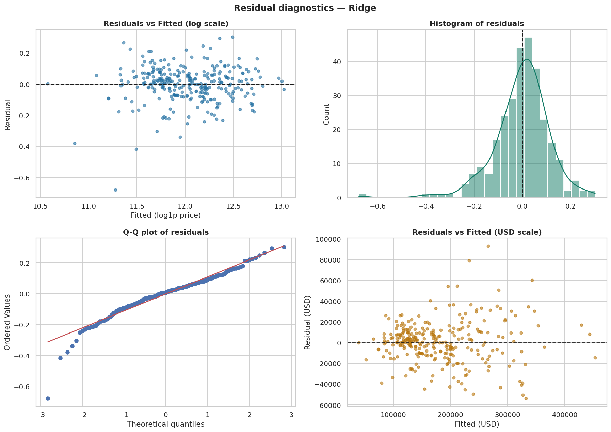

| Diagnostic | Result | Reading |
|---|---|---|
| Residuals vs fitted (log scale) | structureless band around 0; Spearman(\|resid\|, fitted) = 0.03 (p = 0.59) | linear form adequate; constant variance on the log scale |
| Residual distribution | mean −0.002, SD 0.113 (typical error ≈ 11 %), skew −1.08, excess kurtosis 4.78 | bell-shaped but with a **heavy left tail** |
| Normality | Shapiro–Wilk p ≈ 2×10⁻⁹; 3 residuals beyond 3σ, 13 beyond 2σ | not strictly normal → use empirical quantiles (not ±1.96σ) for prediction intervals |
| Largest errors | all six are **over-predictions** (+29 % to +97 %): four low-quality homes (`OverallQual` 2–4) in IDOTRR / OldTown, three `Abnorml` sales | the model cannot see foreclosure / family-sale discounts → route such listings to a human appraiser |

| Ridge: top coefficients | Permutation importance |
|---|---|
| 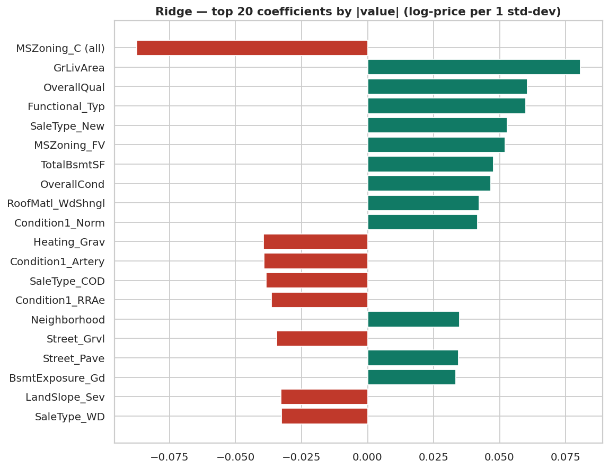 | 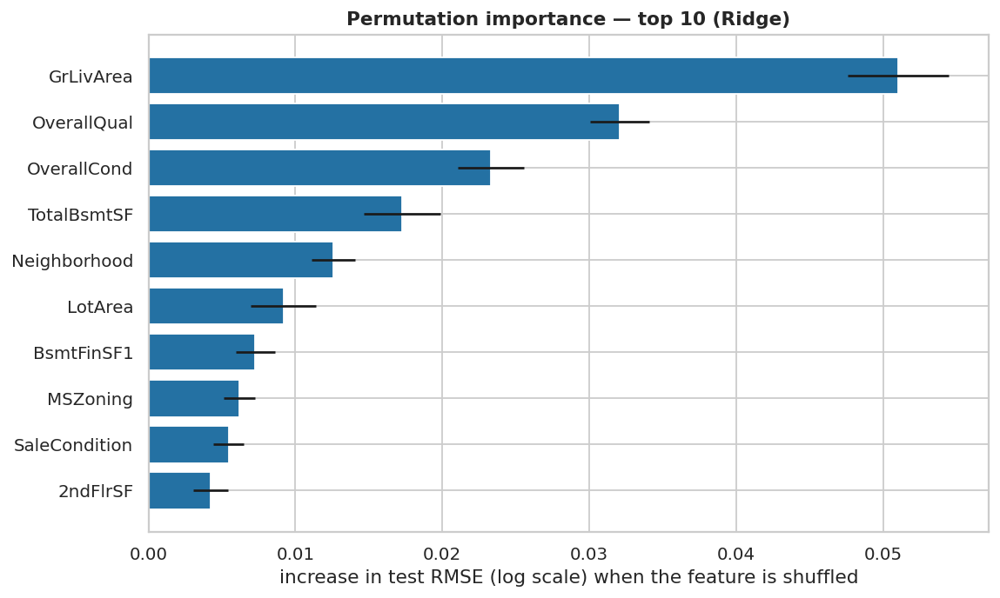 |

---

## 💡 What drives the price? (interpretation)

Permutation importance on the test set ranks the top five drivers: **`GrLivArea` › `OverallQual` › `OverallCond` › `TotalBsmtSF` › `Neighborhood`**.
The table shows "same house, change one thing" what-if predictions from the final model (averaged over the 292 test houses):

| Scenario | Average effect on predicted price |
|---|---|
| **+500 sq ft of living area** | **+12.3 %** (≈ +$20,200) |
| **+1 `OverallQual` point** | **+4.5 %** (≈ +$8,000) |
| Excellent (10) vs Average (5) build quality, same house | **+24.6 %** |
| +1 `OverallCond` point | +4.2 % |
| +500 sq ft of basement | +7.1 % (≈ +$12,600) |
| Priciest (NridgHt) vs cheapest (MeadowV) neighbourhood, same house | **+14.4 %** |
| Kitchen upgraded to Excellent | +3.2 % |
| +1 garage bay | +1.6 % |
| House 20 years older (remodel year unchanged) | −2.1 % |

**Plain-English takeaways for a real-estate professional**
- Price is driven by **how big, how well built, and where**.
- Adding usable area and improving build quality give the strongest uplift; age on its own matters little once size and quality are accounted for.
- The raw median gap between quality-10 and quality-5 homes is ~3×, but holding everything else fixed the model attributes only ~25 % to quality itself — the rest comes from correlated factors (bigger, newer homes in better neighbourhoods).

**SHAP (bonus, tuned XGBoost).** `TotalSF`, `OverallQual`, `GrLivArea`, `Neighborhood` and `OverallCond` have the largest mean |SHAP| values; the waterfall plot explains one individual prediction.

| SHAP beeswarm | SHAP waterfall (one house) |
|---|---|
| 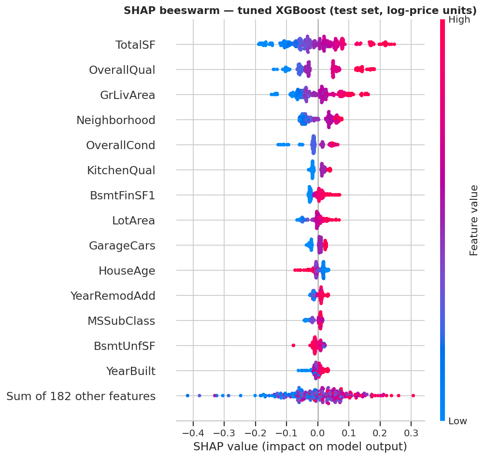 | 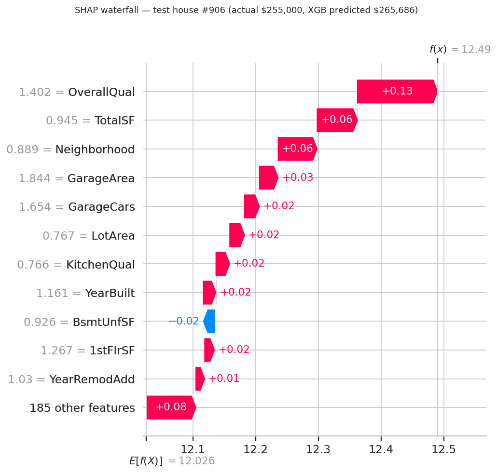 |

---

## 🚀 Saved pipeline & Streamlit web app

### The saved model
`models/house_price_model.pkl` is one `sklearn.pipeline.Pipeline` with three steps:

| Step | Component | Role |
|---|---|---|
| `cleaner` | `HouseCleaner` (`src/house_preprocessing.py`) | raw rows → cleaned + engineered features |
| `prep` | `ColumnTransformer` | impute / log / scale / one-hot / target-encode |
| `model` | `LogTargetRegressor(Ridge)` | trained on `log1p(price)`, **returns USD** |

It was verified to (a) reproduce the evaluated test predictions exactly, and (b) load and predict in a **fresh Python process**.

```python
import sys; sys.path.insert(0, "src")      # house_preprocessing.py is needed to un-pickle the model
import joblib, pandas as pd

pipe = joblib.load("models/house_price_model.pkl")
rows = pd.read_csv("data/train.csv", keep_default_na=False, na_values=["NA"]).drop(columns=["SalePrice"]).head(5)
print(pipe.predict(rows))                  # predicted SalePrice in USD
```

Sample output (`python scripts/predict_example.py`):

| Id | Actual | Predicted |
|---:|---:|---:|
| 1 | $208,500 | $207,045 |
| 2 | $181,500 | $193,349 |
| 3 | $223,500 | $213,511 |
| 4 | $140,000 | $166,713 |
| 5 | $250,000 | $287,929 |

### The Streamlit app
```bash
streamlit run app/app.py        # opens http://localhost:8501
```
- ~20 sidebar inputs (quality, size, neighbourhood, age, bathrooms, garage…); every other feature is set to a *typical* Ames value from `data/feature_defaults.json`.
- Outputs the **estimated price**, a **typical ±11 % range**, comparison with the median price, **what-if charts** (quality, living area), an optional INR conversion (editable rate — illustrative only) and a **model-performance tab**.
- Deploy for free on Streamlit Community Cloud — main file path **`app/app.py`**, Python **3.12**. Full steps and troubleshooting: [`docs/DEPLOYMENT.md`](docs/DEPLOYMENT.md).
- Live app: **PASTE_YOUR_APP_URL_HERE**

---

## 🗂️ Project structure

```
house-price-regression-supervised-learning/
├── README.md
├── requirements.txt
├── notebooks/
│   └── HousePrice_SupervisedLearning.ipynb   fully executed notebook (Steps 1–8)
├── src/
│   └── house_preprocessing.py                cleaning / feature-engineering classes (the .pkl needs this)
├── models/
│   └── house_price_model.pkl                 saved sklearn Pipeline (raw rows in → USD price out)
├── app/
│   └── app.py                                Streamlit web app
├── scripts/
│   └── predict_example.py                    5-row prediction demo
├── data/
│   ├── train.csv                             Ames training file (git-ignored — download from Kaggle)
│   ├── feature_defaults.json                 typical-house defaults used by the app
│   └── README.md
├── images/                                   17 plots saved by the notebook
├── results/                                  metrics.json, model_comparison.csv
├── reports/
│   └── summary_report.md                     ~450-word report
├── docs/
│   └── DEPLOYMENT.md                         Streamlit Cloud deployment guide
└── tests/
    └── test_pipeline.py                      smoke tests (pytest)
```

---

## ▶️ How to run

**Prerequisites:** Python **3.12** (3.11+ works for the libraries; the project was built and tested on 3.12).

```bash
# 1. clone and enter the project
git clone https://github.com/<your-username>/house-price-regression-supervised-learning.git
cd house-price-regression-supervised-learning

# 2. create an environment and install the pinned libraries
python -m venv .venv
source .venv/bin/activate            # Windows: .venv\Scripts\activate
pip install -r requirements.txt

# 3. add the data (download train.csv from the Kaggle link above)
#    -> data/train.csv

# 4a. reproduce the analysis (about 5 minutes on a single CPU core)
cd notebooks && jupyter notebook HousePrice_SupervisedLearning.ipynb      # Run All
#     it (re)writes ../models, ../images and ../results

# 4b. or just use the saved model / app / tests
cd ..
python scripts/predict_example.py
streamlit run app/app.py
pytest -q tests
```

| Command | What it does |
|---|---|
| `python scripts/predict_example.py` | loads the pickle and predicts 5 houses |
| `streamlit run app/app.py` | launches the web app |
| `pytest -q tests` | checks the pipeline returns sensible USD prices and reasonable accuracy |

**Troubleshooting**
| Problem | Fix |
|---|---|
| `ModuleNotFoundError: house_preprocessing` | add `src/` to the path (`sys.path.insert(0, "src")`) — the pickle references that module |
| Pickle warnings / load failure | use Python 3.12 and the pinned `scikit-learn==1.8.0` |
| Notebook can't find the data | place `train.csv` in `data/` and start Jupyter from inside `notebooks/` |

---

## 🔁 Reproducibility
- **Seeds:** `random_state=42` for the split, CV folds, target encoder, models and the random search.
- **Versions:** pinned in `requirements.txt` (Python 3.12.3, pandas 3.0.2, numpy 2.4.4, scikit-learn 1.8.0, xgboost 3.4.1, shap 0.54.1).
- **Verified end to end:** the notebook was re-executed from the final folder layout with zero errors and identical metrics; `metrics.json` and `model_comparison.csv` in `results/` are written by the notebook.
- **Sanity checks inside the notebook:** `HouseCleaner(raw)` equals the step-by-step cleaning; the final pipeline reproduces the evaluated predictions to 6 significant digits; the pickle is reloaded in a new process.

---

## ⚠️ Limitations & future work

**Limitations**
- Trained on **1,458 sales from Ames, Iowa (2006–2010)** — prices, tastes and markets elsewhere (e.g. Indian cities) differ; do **not** use it for real valuations without re-training on local data.
- Over-predicts very cheap, low-quality or abnormal (foreclosure / family) sales — see the residual analysis.
- Small data: gaps among the top models are within CV noise; the test set has 292 rows, so single-split numbers carry ±$2–3k of luck.
- Residuals are heavy-tailed, so ±1.96σ intervals would be miscalibrated (the app's ±11 % band is an approximate ~68 % band).

**Next steps for production**
- More data and richer features: micro-location / geo-coordinates, school and transport scores, listing text and photos, sale-date trend.
- **Stack / blend** Ridge with gradient boosting; try CatBoost and neighbourhood-level **Bayesian hierarchical models**.
- **Quantile regression or conformal prediction** for asymmetric, calibrated prediction intervals.
- Human review for low-quality or abnormal-sale listings; monitoring for data drift and scheduled re-training; an API (FastAPI) in front of the pipeline.

---

## ✅ Exam deliverables checklist

| Marking component | Marks | Where it is |
|---|---:|---|
| **A. Technical completion** — executed `.ipynb` + `.pkl` | 30 | `notebooks/HousePrice_SupervisedLearning.ipynb`, `models/house_price_model.pkl` |
| **B. Recorded video** (face + screen, 5–10 min, MP4/MOV, ≤ 500 MB) | 15 | link below |
| **C. GitHub repository + README** | 5 | this repository |

- [x] Notebook runs top-to-bottom without errors
- [x] All plots are visible in the notebook output
- [x] Model-comparison table present (Step 6)
- [x] Metrics reported in original USD scale (not log scale)
- [x] `house_price_model.pkl` saved and tested; `summary_report.md` written (`reports/`)
- [x] `requirements.txt` and this README explain how to run the project
- [ ] Video recorded and its link pasted below
- [ ] Public GitHub link shared with the examiner

---

## 🎥 Video, links & credits

| | |
|---|---|
| 🎥 **Video walkthrough** (face + screen) | **PASTE_YOUR_VIDEO_LINK_HERE** &nbsp;·&nbsp; file name: `Practical_Exam_YourName_GRID.mp4` |
| 🌐 **Live Streamlit app** | **PASTE_YOUR_APP_URL_HERE** |
| 📚 **Dataset** | [Kaggle — House Prices: Advanced Regression Techniques](https://www.kaggle.com/competitions/house-prices-advanced-regression-techniques/data); Ames Housing data compiled by Dean De Cock |

**Author:** Dhrukesh · Red & White Skill Education — *"Shaping skills for scaling higher."*
